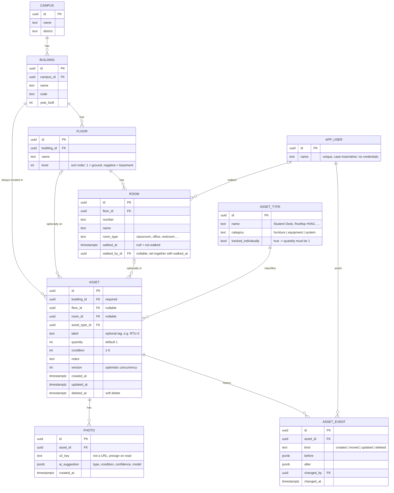

# Campus Walk — Project Scope (v2)

Target: feature-complete **Wed Oct 14 evening**, submit by Thu Oct 15. Budget ≈ 30 hrs (5 hrs/day, Fri–Wed).

## Goal
Make the on-site walk fast and the roll-up automatic. The architect opens a room that already exists, records what's in it (photo → AI suggestion → confirm), marks it walked, and the office sees the campus summary update live.

## Assumptions (call out in README)
- **The floor plan is already known.** Campus → Building → Floor → Room is seeded (or CSV-imported). Architects don't create rooms in the field; they assign assets to them.
- One seeded fictional campus: 4 buildings, ≥30 rooms, some pre-walked rooms and assets so the summary isn't empty.
- No multi-tenancy or roles. The walker enters their name once (stored locally, sent with each write for the audit log). The deployed URL sits behind a shared access code.
- Furniture is **counted**; equipment and systems are **tracked individually**. This matches LRFP practice and avoids matching the same object across photos.

## In scope (core)
**Field**
- Browse Campus → Building → Floor → Room, with walked / not walked badges and progress.
- Room screen: list of assets; add an asset (type, quantity, condition 1–5, photo, note); edit; remove.
- "Building systems" area per building (and per floor) for assets not tied to a room.
- Move an asset to another room, floor or building level; the move is recorded in history.
- Mark a room walked (and undo).

**Office**
- Campus summary, filterable by building:
  - asset counts by type (sum of quantity)
  - assets in poor condition (condition ≤ 2)
  - rooms not yet walked, grouped by building and floor
  - % of rooms walked

## Stretch (planned)
1. **AI suggestion** — photo → Claude on Bedrock → suggested `asset_type` + `condition` + short note. Shown pre-filled; the architect confirms or overrides. The suggestion is stored on the photo for audit.
2. **Two walkers at once** — optimistic concurrency via `asset.version`. A stale write returns 409 with the current record; the UI shows "updated by X, review changes".
3. **CSV import/export** — export assets and rooms. Importing rooms is the realistic version of "upload a floor plan".
4. *(If ahead on Tue)* **Offline-lite** — service worker caches the app and the campus tree; writes queue in IndexedDB and replay on reconnect (version checks still apply).

## Cut (→ README "What I'd do next")
- Floor plan / blueprint parsing to auto-generate rooms → replaced by seed + CSV import.
- Multi-photo YOLO detection and duplicate matching → replaced by single-photo AI suggestion + `quantity`.
- On-device detection (YOLO-World / open-vocabulary ONNX in the browser).
- Gaussian splat room capture (WebGPU viewer).
- Auth/roles, multiple campuses per architect, full offline-first sync with CRDTs.
- **CouchDB + PouchDB** (considered 10/12 for offline + two-walker sync, honorable mention in the README's technology considerations). Rejected for this submission: it would discard the finished Postgres API with 2.5 days left, the office roll-ups are relational, location integrity lives in DB constraints, the brief grades "an API you wrote" (Pouch replication would replace most of it), sync conflicts still need a resolution UI, and neither AWS nor Azure offers managed CouchDB. The version-field 409 + IndexedDB outbox covers the same stretch items at a fraction of the cost.

## Data model



### Where an asset lives (the rooftop HVAC question)
`building_id` is required; `floor_id` and `room_id` are optional and narrow the location:

| Example | building_id | floor_id | room_id |
|---|---|---|---|
| Rooftop HVAC, boiler, roof | ✔ | — | — |
| Hallway fire alarm panel | ✔ | ✔ | — |
| 24 student desks in Rm 104 | ✔ | ✔ | ✔ |

The database enforces consistency, so no trigger is needed:
- `CHECK (room_id IS NULL OR floor_id IS NOT NULL)`
- composite FK `(room_id, floor_id) → room(id, floor_id)`
- composite FK `(floor_id, building_id) → floor(id, building_id)`
- With Postgres `MATCH SIMPLE`, a composite FK is skipped when any of its columns is null, which is exactly the "optional level" behavior we want.

Why not fake "Roof" rooms: they'd pollute "rooms not walked". Why not a polymorphic `parent_id`: no referential integrity, and rollups get awkward.

**Moves:** setting a new `(building_id, floor_id, room_id)` with the `version` from the last read writes an `asset_event(kind='moved')`. Moving across buildings is allowed.

**Condition scale:** 5 Excellent · 4 Good · 3 Fair · 2 Poor · 1 Critical. "Poor condition" = ≤ 2 (one constant).

**Quantity rule:** if `asset_type.tracked_individually`, quantity = 1 (validated in the API). Counts by type = `SUM(quantity)`.

## Field flow
1. Pick building → floor → room (rooms show walked badge; "Building systems" sits at the top of each building).
2. Room screen → **Add asset** → take photo (`<input type=file accept=image/* capture=environment>`).
3. Photo uploads straight to S3 (presigned PUT) → API calls Bedrock → form pre-fills type + condition + note.
4. Architect confirms or edits type, quantity (stepper) and condition (five large buttons), then saves.
5. Repeat; **Move** on any asset opens the same building/floor/room picker (recently used rooms first).
6. **Mark room walked** → back to the room list, with the next unwalked room highlighted.

Usability targets: phone-first, one-handed, big tap targets, recently used asset types at the top of the picker.

## Office flow
- Summary page: progress bar, counts by type (table + bar chart), poor-condition list linking to the asset, unwalked rooms grouped by building/floor.
- Building filter; CSV export of assets; CSV import of rooms.

## API sketch (REST, JSON, zod-validated)
```
GET    /campuses                     list
GET    /campuses/:id/tree            buildings → floors → rooms (+ walked, asset counts)
GET    /campuses/:id/summary?buildingId=
GET    /rooms/:id                    room + ancestry + assets
POST   /rooms/:id/walked             mark walked by X-Walker;  DELETE /rooms/:id/walked clears
GET    /buildings/:id/systems        building- and floor-level assets (no room)
GET    /assets/:id                   asset + event history
POST   /assets                       { roomId | floorId | buildingId, assetTypeId, quantity, condition, label?, notes? }
                                     server resolves the levels above the one given
PATCH  /assets/:id                   body includes version; 409 with current record on mismatch
POST   /assets/:id/move              { roomId | floorId | buildingId, version }
DELETE /assets/:id                   { version }; soft delete
GET    /asset-types
POST   /uploads                      { contentType } → { key, url (presigned PUT), expiresInSeconds }
POST   /photos                       { s3Key, assetId? } → photo { url, suggestion }; runs the AI suggestion
                                     photos taken before the asset exists are attached via POST /assets { photoIds }
DELETE /photos/:id
GET    /campuses/:id/assets.csv      GET /campuses/:id/rooms.csv (doubles as the import template)
POST   /campuses/:id/rooms/import    body = CSV; all-or-nothing, 400 lists row errors with line numbers

GET    /users                       POST /users { name } find-or-create (case-insensitive)

Identity: the client picks a user (`POST /users`) once and sends `X-User-Id` on writes; it becomes
the event's changed_by and the room's walker. Writes without a known user get 401. No credentials or
roles yet: authentication and RBAC would hang off `app_user` later and are out of scope.
Errors: `{ error, details }`; zod issues in details for 400, the current record for 409.
```

## Architecture
- **Monorepo (pnpm):** `apps/web` (React + Vite PWA, TanStack Query), `apps/api` (Hono on Node), `packages/shared` (zod schemas + types shared by the web app and API), `infra` (AWS CDK, TS).
- **DB:** Postgres + Drizzle (migrations + seed script). CouchDB/PouchDB was weighed for offline sync and set aside (see Cut).
- **Local:** `docker compose up` → Postgres + RustFS (S3-compatible; MinIO's public images were withdrawn). No Docker? `DATABASE_URL=pglite://.data/pg` runs embedded Postgres. The AI suggestion is stubbed when AWS credentials are absent.
- **AWS:** CloudFront + S3 (web) · ECS Fargate behind an ALB (api) · RDS Postgres (t4g.micro) · S3 (photos) · Bedrock (Claude vision) via the task role · Secrets Manager for the DB credentials.

## Testing (the parts that matter)
- Location rules: DB rejects inconsistent building/floor/room; API maps those errors to 400.
- Moves: room→room, room→building level, cross-building; event written.
- Concurrency: stale version → 409, no write.
- Summary queries: counts by type use quantity; poor threshold; unwalked rooms.
- Quantity rule for individually tracked types.
- AI suggestion parsing: malformed or low-confidence model output degrades to an empty suggestion.
- Integration tests run against real Postgres (Testcontainers or the compose DB); a light component test for the condition picker / room flow.

## Schedule
| Day | Focus |
|---|---|
| Fri 10/9 | Scaffold monorepo, compose, Drizzle schema + constraints, seed data |
| Sat 10/10 | API endpoints + integration tests (location, move, version, summary) |
| Sun 10/11 | Field UI: browse, room screen, add/edit/move asset, mark walked |
| Mon 10/12 | Photos (S3 presign) + Bedrock suggestion, office summary page |
| Tue 10/13 | CDK deploy to AWS, CSV import/export; offline-lite if ahead |
| Wed 10/14 | Polish, README (model, decisions, trade-offs, AI usage, next steps), demo video |

## Open questions
- Seed realism: model on a typical K-8 campus (main classroom building, gym, admin, portables)?
