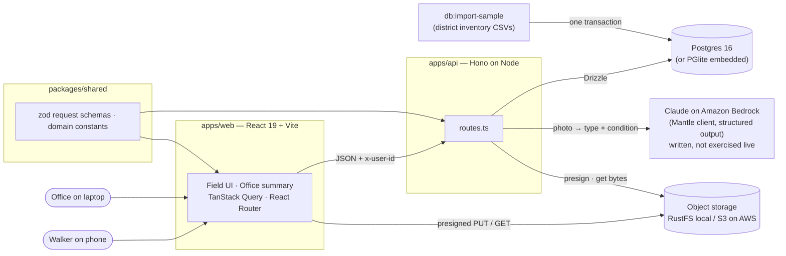
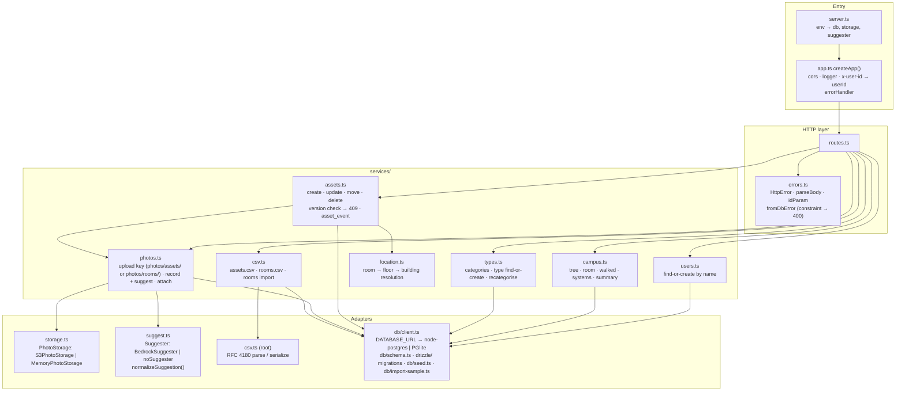
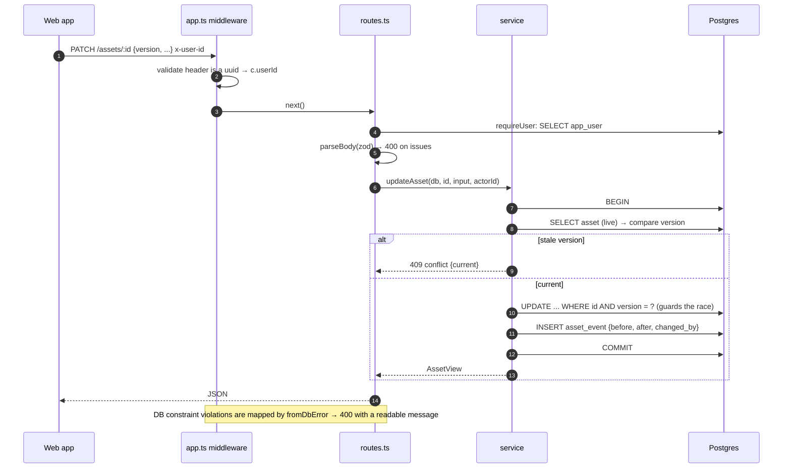
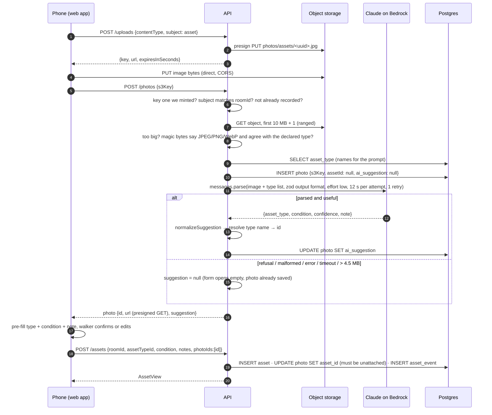
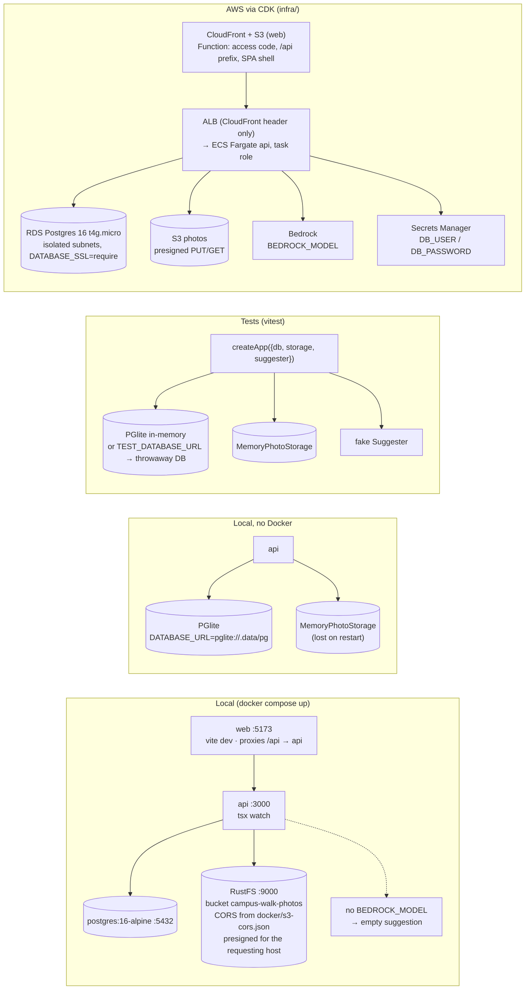
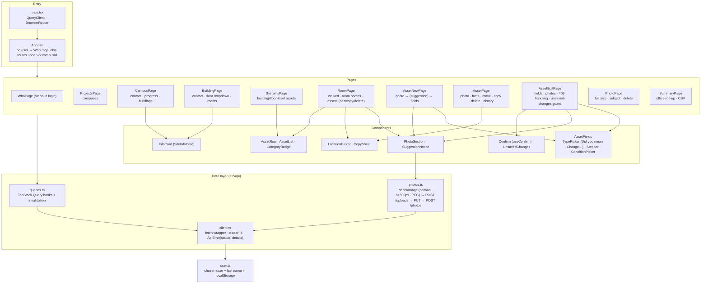

# Campus Walk — Systems Diagram

Status as of 2026-10-14. Everything shown is built and tested, with two exceptions: the AWS stack in `infra/` is synthesised and its API image verified locally but has not been deployed (descoped for the submission), and the Bedrock call behind the photo suggestion is written but has never run against a live model (no account access; it is tested with a fake suggester).
Mermaid blocks render in Obsidian's reading view.

## 1. System context

## 2. API internals

## 3. Request lifecycle (any write)

## 4. Photo → AI suggestion → asset

The intended flow. The Bedrock call has not been exercised against a live model (no account access for this submission); everything else in the diagram runs, and the suggestion steps are tested with a fake suggester.

## 5. Data model

Moved to [data-model.md](data-model.md): the table summary, the full ER diagram and the modelling decisions.

## 6. Environments

## 7. Web app (apps/web)

Field flow: pick a name once → projects → campus → building (floor dropdown) → room → **Add asset** (photo first; with Bedrock configured the suggestion pre-fills type, condition and note, otherwise the form opens empty; the walker confirms) → **Mark room walked** → back to the building with the next unwalked room outlined. A stale save (409) shows "Updated by X while you were editing" with their changes and a button to load their version.

## 8. Endpoint map

| Area | Endpoints | Service |
|---|---|---|
| Identity | `GET/POST /users` | users.ts |
| Browse | `GET /campuses`, `GET /campuses/:id/tree`, `GET /rooms/:id`, `GET /buildings/:id/systems` | campus.ts |
| Catalogue | `GET /asset-categories`, `GET /asset-types`, `POST /asset-types` (find-or-create by name), `PATCH /asset-types/:id` (category, counting) | types.ts |
| Walk | `POST/DELETE /rooms/:id/walked` | campus.ts |
| Assets | `GET /assets/:id`, `POST /assets`, `PATCH /assets/:id`, `POST /assets/:id/move`, `POST /assets/:id/copy`, `DELETE /assets/:id` | assets.ts |
| Photos | `POST /uploads`, `POST /photos` (asset, room, or unattached), `GET /photos/:id`, `DELETE /photos/:id` | photos.ts |
| Office | `GET /campuses/:id/summary?buildingId=` | campus.ts |
| CSV | `GET /campuses/:id/assets.csv`, `GET /campuses/:id/rooms.csv`, `POST /campuses/:id/rooms/import` | csv.ts |

Writes require `x-user-id` (401 otherwise); reads do not. Errors are `{ error, details }`: zod issues on 400, the current record on 409.
