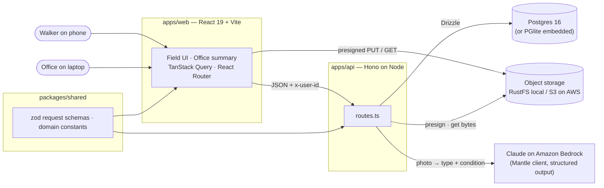
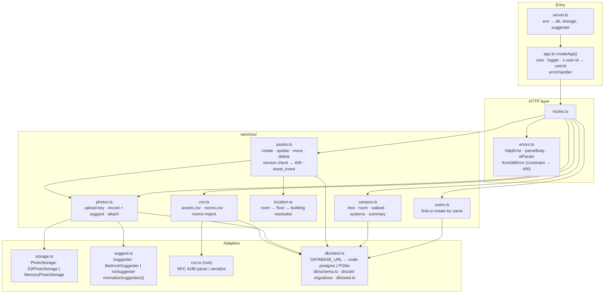
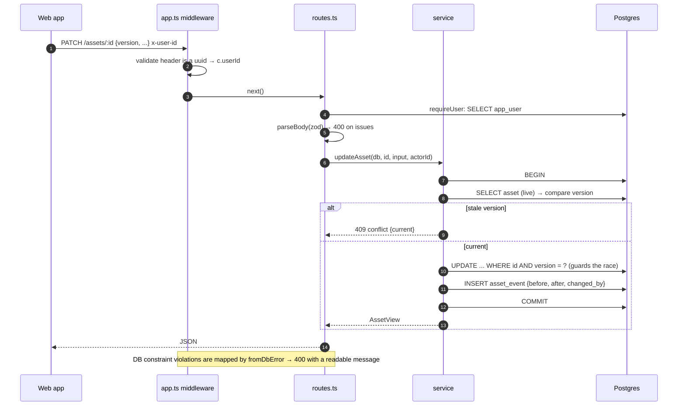
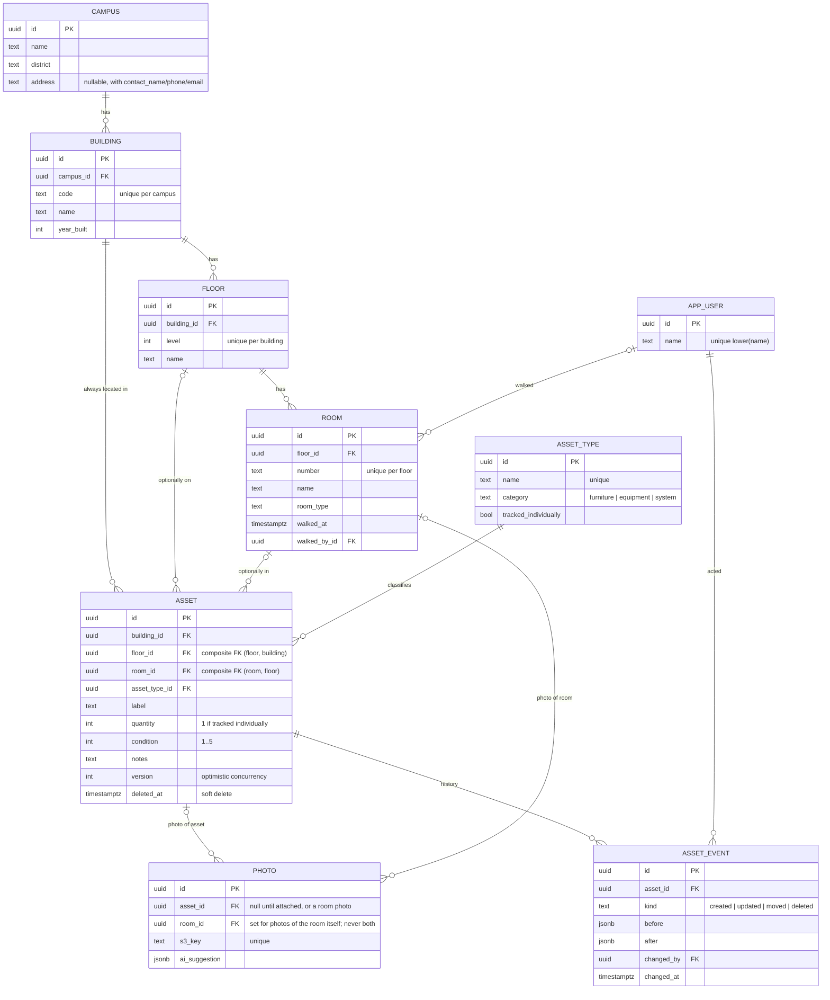
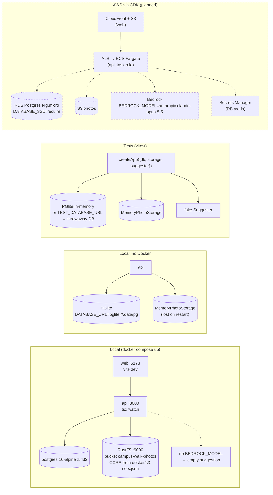
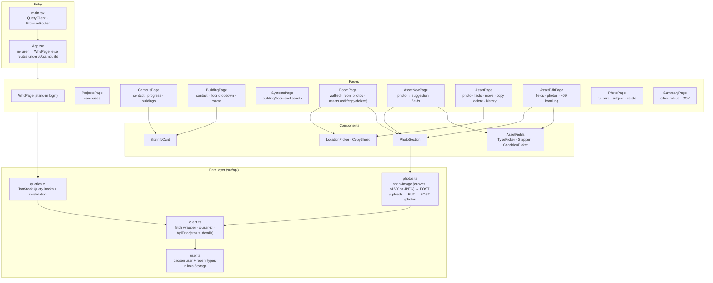

# Campus Walk — Systems Diagram

Status as of 2026-10-12. **Solid** = built and tested. **Dashed** = planned (AWS deploy).
Mermaid blocks render in Obsidian's reading view.

## 1. System context



## 2. API internals



## 3. Request lifecycle (any write)



## 4. Photo → AI suggestion → asset

```mermaid
sequenceDiagram
  autonumber
  participant P as Phone (web app)
  participant API as API
  participant S3 as Object storage
  participant B as Claude on Bedrock
  participant D as Postgres

  P->>API: POST /uploads {contentType}
  API->>S3: presign PUT photos/<uuid>.jpg
  API-->>P: {key, url, expiresInSeconds}
  P->>S3: PUT image bytes (direct, CORS)
  P->>API: POST /photos {s3Key}
  API->>API: key matches PHOTO_KEY? not already recorded?
  API->>S3: GET object bytes
  API->>D: SELECT asset_type (names for the prompt)
  API->>B: messages.parse(image + type list, zod output format, effort low)
  alt parsed and useful
    B-->>API: {asset_type, condition, confidence, note}
    API->>API: normalizeSuggestion → resolve type name → id
  else refusal / malformed / error / > 4.5 MB
    API->>API: suggestion = null (form opens empty)
  end
  API->>D: INSERT photo {s3Key, assetId: null, ai_suggestion}
  API-->>P: photo {id, url (presigned GET), suggestion}
  P->>P: pre-fill type + condition + note; walker confirms or edits
  P->>API: POST /assets {roomId, assetTypeId, condition, notes, photoIds:[id]}
  API->>D: INSERT asset · UPDATE photo SET asset_id (must be unattached) · INSERT asset_event
  API-->>P: AssetView
```

## 5. Data model



Location integrity lives in the database: `asset(floor_id, building_id)` references `floor(id, building_id)` and `asset(room_id, floor_id)` references `room(id, floor_id)`, so a room on the wrong floor or a floor in the wrong building cannot be stored. `location.ts` fills in the levels above the one the client sent and turns the same violations into readable 400s.

## 6. Environments



## 7. Web app (apps/web)



Field flow: pick a name once → projects → campus → building (floor dropdown) → room → **Add asset** (photo first; the suggestion pre-fills type, condition and note; the walker confirms) → **Mark room walked** → back to the building with the next unwalked room outlined. A stale save (409) shows "Updated by X while you were editing" with their changes and a button to load their version.

## 8. Endpoint map

| Area | Endpoints | Service |
|---|---|---|
| Identity | `GET/POST /users` | users.ts |
| Browse | `GET /campuses`, `GET /campuses/:id/tree`, `GET /rooms/:id`, `GET /buildings/:id/systems`, `GET /asset-types` | campus.ts |
| Walk | `POST/DELETE /rooms/:id/walked` | campus.ts |
| Assets | `GET /assets/:id`, `POST /assets`, `PATCH /assets/:id`, `POST /assets/:id/move`, `POST /assets/:id/copy`, `DELETE /assets/:id` | assets.ts |
| Photos | `POST /uploads`, `POST /photos` (asset, room, or unattached), `GET /photos/:id`, `DELETE /photos/:id` | photos.ts |
| Office | `GET /campuses/:id/summary?buildingId=` | campus.ts |
| CSV | `GET /campuses/:id/assets.csv`, `GET /campuses/:id/rooms.csv`, `POST /campuses/:id/rooms/import` | csv.ts |

Writes require `x-user-id` (401 otherwise); reads do not. Errors are `{ error, details }`: zod issues on 400, the current record on 409.
