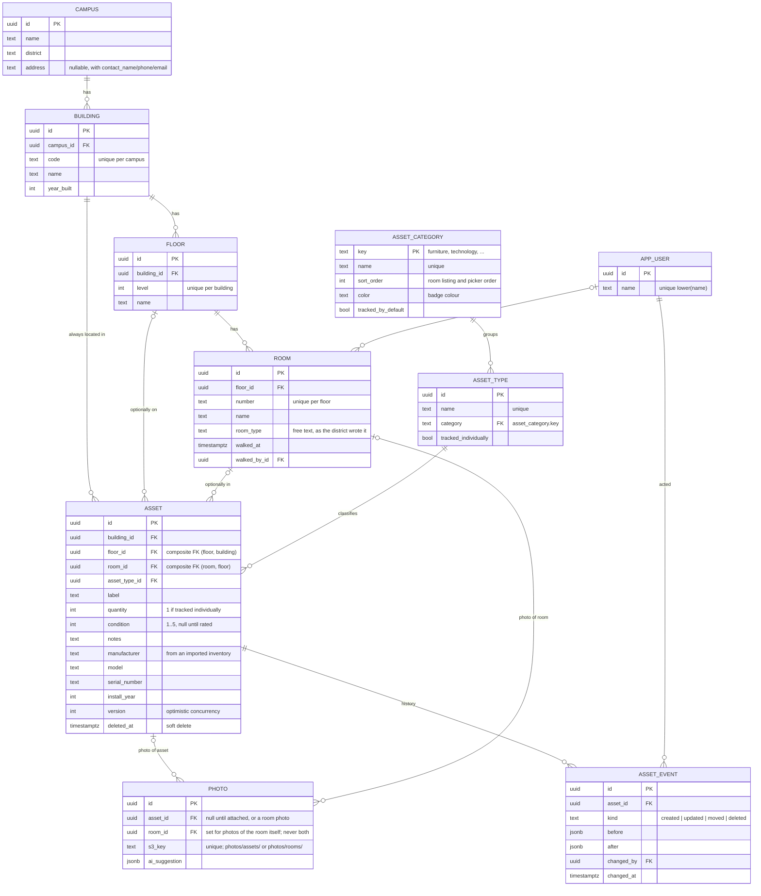

# Campus Walk — Data model

Campus → Building → Floor → Room is the floor plan, known before the walk. An asset always has a building, and optionally a floor and a room. Everything below is in `apps/api/src/db/schema.ts`, with migrations in `apps/api/drizzle/`.

| Table | What it holds |
|---|---|
| `campus`, `building`, `floor`, `room` | The hierarchy. Building codes are unique per campus, floor levels per building, room numbers per floor. A room has a free-text `room_type` and `walked_at` / `walked_by_id`. |
| `asset_category` | Furniture, Technology, Equipment, System (data, not an enum): name, sort order, colour, and whether new types default to one record per unit. |
| `asset_type` | The shared catalogue: name (unique), category, and `tracked_individually` (one record per unit, or counted with `quantity`). |
| `asset` | Where it is (building, floor?, room?), its type, `quantity`, `condition` (1–5, or null for "on the inventory, not rated yet"), label, notes, make/model/serial/install year from an imported inventory, `version` for concurrent edits, `deleted_at` for soft delete. |
| `photo` | One S3 object: of an asset, of a room, or not yet attached (taken before the asset was saved). Holds what the model suggested. |
| `asset_event` | Every create, update, move and delete, with before/after snapshots and who did it. |
| `app_user` | The walker's name; no credentials yet. |

## Modelling decisions

**Where an asset lives.** `building_id` is required; `floor_id` and `room_id` are optional and narrow it. A rooftop unit is building-level, a corridor fire panel is floor-level, 24 desks are in a room. Composite foreign keys `(room_id, floor_id) → room` and `(floor_id, building_id) → floor` plus a check constraint make an inconsistent triple impossible to store, so the API resolves whichever level the client sends and the database catches anything that disagrees. Fake "Roof" rooms were rejected because they would show up in "rooms not walked".

Location integrity lives in the database: `asset(floor_id, building_id)` references `floor(id, building_id)` and `asset(room_id, floor_id)` references `room(id, floor_id)`, so a room on the wrong floor or a floor in the wrong building cannot be stored. `location.ts` fills in the levels above the one the client sent and turns the same violations into readable 400s.

**Counted vs tracked.** Furniture is a count (`quantity`); technology, equipment and systems are one record each (`tracked_individually` on the type, enforced by the API). This matches how assessments are written up, keeps the walk fast, and avoids trying to match the same chair across photos.

**History.** Every create, update, move and delete writes an `asset_event` with before/after snapshots and who did it. Deletes are soft so the history keeps pointing at something.

**Lists are data, not code.** Asset categories live in an `asset_category` table (key, name, sort order, colour, whether new types in it default to one record per unit), seeded with Furniture, Technology, Equipment and System by migration. The type picker's chips and groups, the order a room's assets are listed in, and badge colours all read it, so a district that wants "Grounds" or "Kitchen" gets it with an insert; the inventory import matches category wording against the same table. There is no screen to add one yet, which is deliberate: someone should own that list, or it drifts into "Tech", "IT" and "Technology". A type's category can be changed in place because every asset follows its type. That is a catalogue-wide change made from the field form, unversioned and not in any history, unlike every asset edit; for now it is behind an explicit "Change for everyone" confirmation, and in production it belongs to a catalogue-maintainer role and a change log of its own ([What's next](../README.md#whats-next), items 2 and 3). Copying an asset leaves its label behind along with photos and serial number, since the label is where an asset tag lives and one tag names one item. Room type is free text: it is only ever displayed, so a district's "Band Hall" or "Training Room" needs no code change. Condition is 1–5 or null; null means "on the inventory, not yet walked", which is a real state once a walk starts from existing records rather than an empty room.

**Photos.** A photo is of one asset, of the room itself, or not yet attached (taken on the add-asset screen before the asset is saved), never both. Room and asset photos are stored under separate S3 prefixes (`photos/rooms/`, `photos/assets/`); the labels for either set stay in these tables. The upload flow is in [decisions.md](decisions.md).
